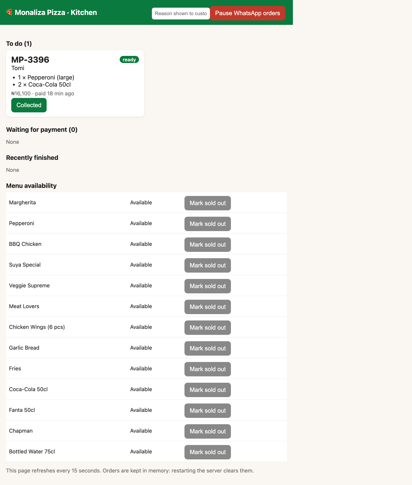

# Monaliza Pizza: WhatsApp ordering teammate on Chord

**Problem.** On a Saturday at Monaliza Park, Abuja, the pizza kiosk has a long queue. It's run by one person, who has to take orders, take payment and bake at the same time. Customers walk back and forth across the park to check whether their pizza is ready.

**Solution.** A Chord teammate on WhatsApp shows the menu, takes the order, sends a **Paystack** payment link, confirms the payment, and answers "is my pizza ready?". The owner just bakes and taps **Ready** on the [kitchen board](#the-kitchen-board-owners-screen), a web page on their phone. The customer walks to the kiosk once.

This repo contains:

| Path | What it is |
|---|---|
| [`skills/monaliza-pizza-ordering/`](skills/monaliza-pizza-ordering/) | The Chord skill: `SKILL.md`, plus references (policies, menu guide, example conversation) |
| [`src/`](src/) | The custom tool: an **MCP server** (Streamable HTTP) that Chord calls, plus the Paystack webhook, the payment-return page and the [kitchen board](#the-kitchen-board-owners-screen) ([`src/http/kitchen.ts`](src/http/kitchen.ts)) |
| [`scripts/deploy-azure.sh`](scripts/deploy-azure.sh) | Builds the image in ACR and deploys it to Azure Container Apps (one replica) |
| [`scripts/chord-setup.mjs`](scripts/chord-setup.mjs) | Registers the MCP server in Chord, scopes it to the teammate, probes it, and uploads/publishes the skill |
| [`scripts/smoke-test.mjs`](scripts/smoke-test.mjs) | Calls the deployed server over MCP, the same way Chord does |
| [`docs/FIELD_NOTES.md`](docs/FIELD_NOTES.md) | Deployment field notes (problems hit, how they were diagnosed, and what Chord could change) |
| [`docs/GO_LIVE.md`](docs/GO_LIVE.md) | Go-live note for the business owner |
| [`docs/TEST_LOG.md`](docs/TEST_LOG.md) | Live simulator test log: happy path, off-menu items, misspellings, gibberish, fake "I paid" and the ready confirmation |

## How it works

```
Customer (WhatsApp) ──► Chord teammate (skill: monaliza-pizza-ordering)
                              │  MCP tools/call (bearer token)
                              ▼
               Monaliza Pizza tools server (Azure Container Apps)
               ├─ get_menu · create_order · get_order_status
               ├─ find_my_orders · retry_payment · cancel_order
               ├─ in-memory order store
               ├─ Paystack: /transaction/initialize, /transaction/verify
               ├─ POST /webhooks/paystack  (HMAC-SHA512 verified)
               ├─ GET  /payment/complete   (customer lands here after paying)
               └─ GET  /kitchen            (owner's board: Preparing → Ready → Collected,
                                            mark items sold out, pause WhatsApp orders)
```

Design choices worth knowing:

- **The server owns the money maths.** `create_order` prices every line from the menu; the model never adds up totals. The skill tells the agent to send the returned `total` and `payment_link` exactly as given.
- **Payment is confirmed only by Paystack.** Paid status comes from `GET /transaction/verify`, triggered by the signed webhook, the return page, or the customer saying "paid". It never comes from webhook body amounts or from what the customer claims. A missed webhook can't strand a paid customer, because every status check re-verifies unpaid orders.
- **Failures are explicit.** Paystack timeouts, bad keys and outages return `payment_provider_error`, and no order is kept. Declined payments become `payment_failed` with a `retry_payment` path. Underpayment, wrong currency, or payment after cancelling becomes `needs_review` for the owner. Unpaid links expire after 30 minutes. Every tool result includes `what_to_tell_customer` so the agent relays the right thing.
- **Built for a one-person kitchen.** The queue position and ETA come from the real oven queue (4 pizzas per 8-minute bake). The owner can mark items sold out or pause WhatsApp orders from the [kitchen board](#the-kitchen-board-owners-screen), and the agent sees that immediately through `get_menu` and `create_order`.
- **Optional push when ready.** If `CHORD_API_KEY`/`CHORD_WORKSPACE_ID` are set, tapping **Ready** finds the customer's Chord thread by WhatsApp number and posts "your order is ready" (take-over → message → hand-back). Without them, customers ask for status, which is the core flow.

## The kitchen board (owner's screen)

The kitchen board is the owner's side of the system. It's a password-protected web page served by the same tool server, at **`/kitchen`**:

- Live: https://monaliza-pizza-tools.redbush-948401c2.southafricanorth.azurecontainerapps.io/kitchen
- Local: http://localhost:8080/kitchen

The browser asks for a login. Use any username; the password is `KITCHEN_PASSWORD` from `.env`. Keep it open on a phone or tablet at the kiosk. It refreshes every 15 seconds.



| Section | What the owner does | What the WhatsApp agent sees |
|---|---|---|
| **To do** | Paid orders appear here automatically. Tap **Start preparing**, then **Mark READY**, then **Collected** when the customer shows their code. **Cancel** is for refunds, which are done in the Paystack dashboard. | `get_order_status` reports `paid` (with queue position and ETA), then `preparing`, then `ready`, at which point the agent says "come to the window with MP-1234". |
| **Waiting for payment** | Nothing. These are unpaid orders, which are never cooked. | The order is `awaiting_payment`, and the agent keeps offering the link. |
| **Menu availability** | **Mark sold out** or **Back in stock**. | `get_menu` hides the item, and `create_order` rejects it as `sold_out`. |
| **Pause WhatsApp orders** (top bar) | Type a reason (e.g. "Oven full, back at 5pm") and pause. | `get_menu` returns `accepting_orders: false`, and the agent relays the reason instead of taking orders. |

Orders that need a human (wrong amount paid, or paid after cancelling) show up in **To do** in red as `needs review`.

## Run it locally

```bash
cp .env.example .env         # add your Paystack TEST secret key (sk_test_...)
npm install
npm test                     # 29 tests: order rules, payments, webhook signature, MCP end to end
npm run dev                  # http://localhost:8080  (MCP at /mcp, board at /kitchen)
```

The server refuses to start with a live Paystack key.

## Deploy (Azure Container Apps)

```bash
az login && az account set --subscription <id>
./scripts/deploy-azure.sh    # builds in ACR, deploys 1 replica (0.25 vCPU / 0.5 GiB), prints URLs
node scripts/smoke-test.mjs  # checks auth, lists tools, calls get_menu/create_order/status over MCP
```

Exactly one replica (`min = max = 1`): the order store is in memory, so a second replica would have different orders and scaling to zero would wipe them.

Then in the **Paystack dashboard (Test mode) → Settings → API Keys & Webhooks**, set the webhook URL to `https://<app>/webhooks/paystack`.

## Connect to Chord

1. Create a teammate in the Chord app and upload `skills/monaliza-pizza-ordering/` (or let the script do it).
2. Either register the MCP server in the app (Teammate settings → Tools → Add tool; URL `https://<app>/mcp`, bearer auth with `MCP_AUTH_TOKEN`), or put `CHORD_API_KEY`, `CHORD_WORKSPACE_ID` and `CHORD_TEAMMATE_ID` in `.env` and run:
   ```bash
   node scripts/chord-setup.mjs   # register MCP server → scope to teammate → enable → discover tools → health → publish skill
   ```
3. Test in the WhatsApp simulator: https://chat.tsglabs.dev/c/YJMfoXFJX3K-nwzsHntrzkG4

If your Paystack account passes transaction fees to customers, set `PAYSTACK_FEES_PASSED_TO_CUSTOMER=true`. The agent then quotes the checkout amount including the fee.

**Paystack test cards** (any future expiry): success `4084 0840 8408 4081`, CVV `408`, no PIN/OTP. Declined `4084 0800 0000 5408`, CVV `001`. Insufficient funds `4084 0800 0067 0037`, CVV `787`. Use the declined card to see the failure → `retry_payment` path.

## Tested

- `npm test`: 29 passing tests. They cover pricing, sold-out, oversize and paused orders; Paystack down (no order kept); verify-based payment; idempotent webhook; underpayment → review; declined → retry → paid; expiry; Paystack verify outage during status checks; cancel rules; the kitchen state machine with a single ready notification; queue order; phone formats; the MCP protocol end to end with a real client; webhook signature rejection; kitchen auth and the cross-site POST block.
- The live deployment was checked with `scripts/smoke-test.mjs`: 401 without the token, 6 tools discovered, menu served, and a real Paystack link created, verified and cancelled.
- Tested end to end in the Chord WhatsApp simulator (see [docs/TEST_LOG.md](docs/TEST_LOG.md)): real Paystack test payments, the kitchen board moving orders to Ready, and adversarial messages. The whole run used 0.68 Chord credits.

## How I used AI tools

I built this with an AI coding assistant (GitHub Copilot in VS Code). It read the brief and the Chord docs, wrote the server, tests, skill and scripts, ran the Azure deployment, and drafted these docs. I chose the problem, the scope and the business rules, and reviewed the output. The agent itself runs on Chord.
